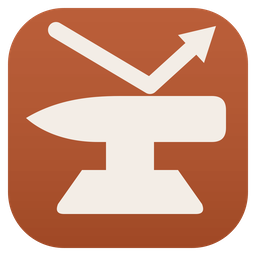
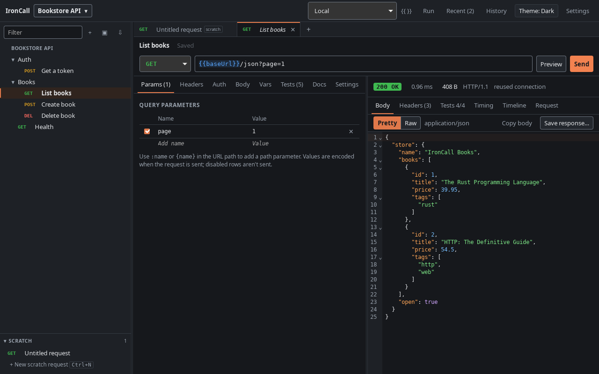
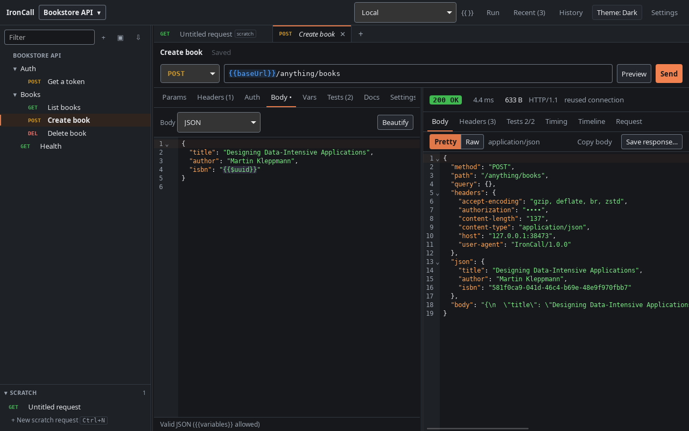
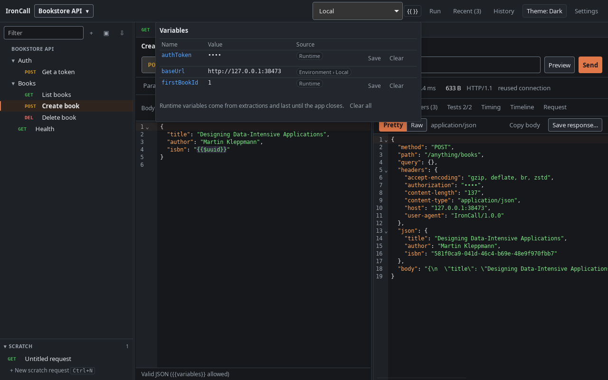
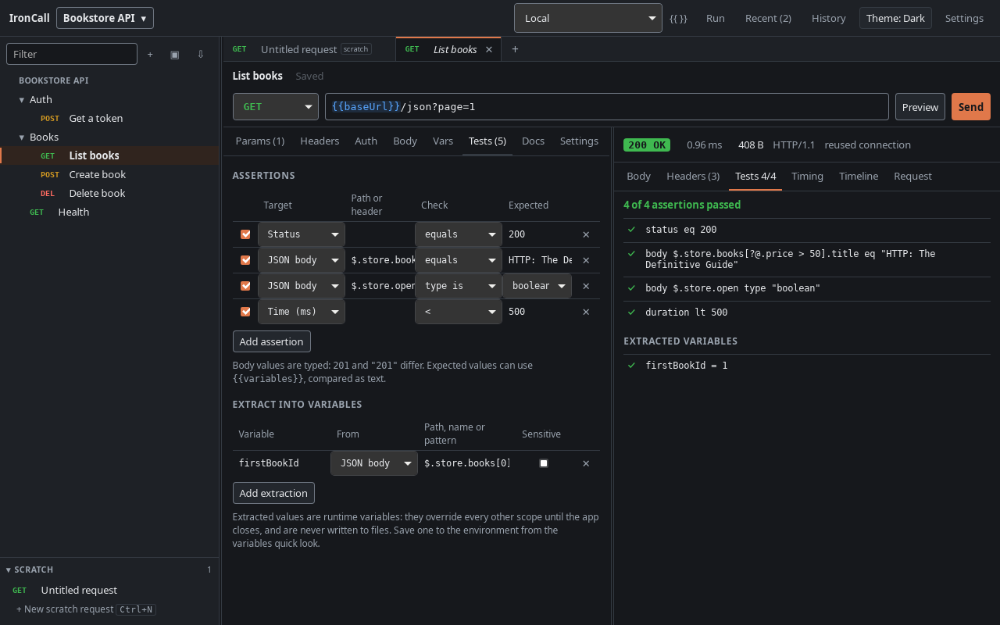
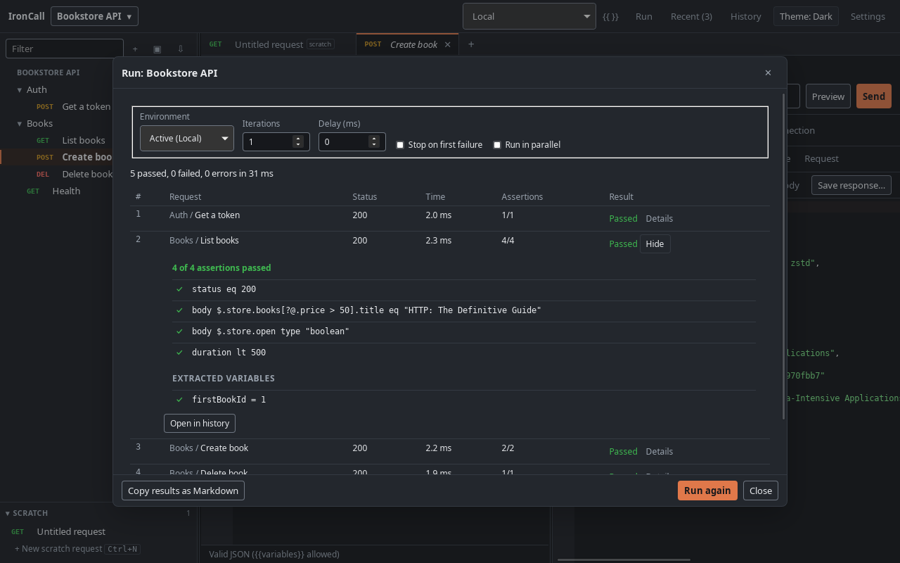
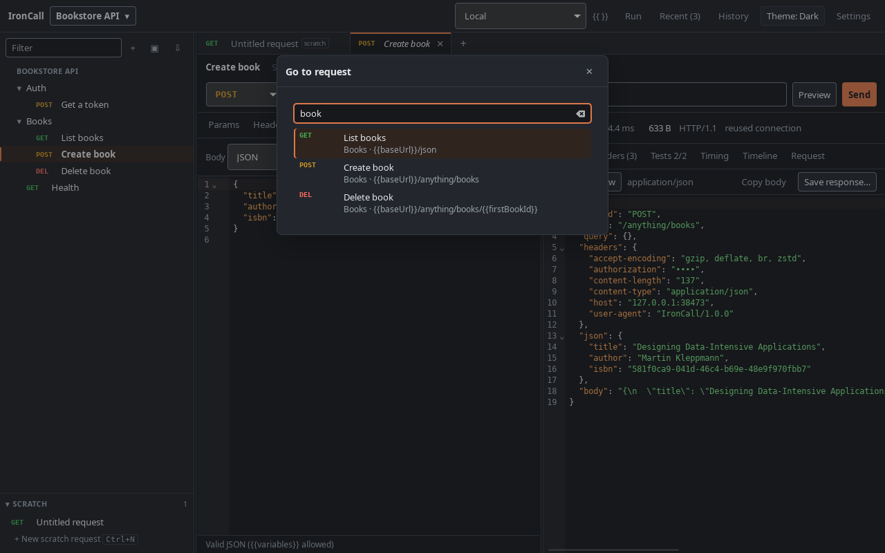
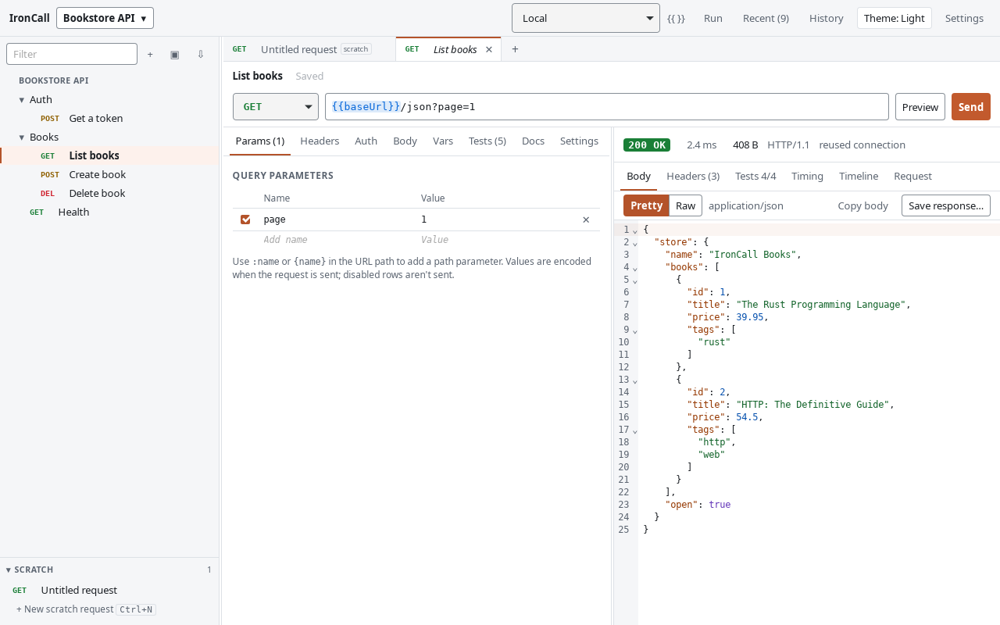

<div align="center">



# IronCall

**A fast, local-first API client for people who live in git.**

Requests are plain YAML files you commit next to your code. Secrets stay on your machine.
Nothing leaves your computer except the requests you send.


[Features](#features) · [Get started](#get-started) · [User guide](docs/user-guide.md) · [File format](docs/file-format.md) · [Changelog](CHANGELOG.md)

<br>



</div>

## Why IronCall

|  |  |
|---|---|
| 🗂️ **Plain files, real diffs** | A workspace is a folder of YAML with stable IDs and byte-identical re-saves. Review API changes in pull requests like any other code. |
| 🔒 **Secrets never hit the repo** | Secret values live in the OS keychain or an encrypted file. They're masked in history, logs, the timeline and cURL exports. |
| ⚡ **Built for big responses** | A 100MB response shows its first rows in under half a second and scrolls smoothly. Search and pretty-printing run in Rust, not in the UI. |
| ✅ **Tests without scripts** | Declarative assertions and value extraction, chained requests, and a collection runner, with no JavaScript sandbox to trust. |
| 📴 **Offline and private** | No account, no cloud sync, no telemetry. A built-in echo server means even the sample workspace works on a plane. |

## Features

### Requests and responses
- Any HTTP method; path and query parameters kept in sync with the URL; JSON, text, XML,
  form, multipart and file bodies; Basic, Bearer and API key auth inherited from folders.
- Its own HTTP engine (hyper and rustls): HTTP/1.1 and HTTP/2, a DNS / connect / TLS / TTFB
  waterfall, TLS and certificate details, a `curl -v`-style timeline, proxies and extra
  CA certificates.
- Image, PDF and sandboxed HTML previews, plus a history of every send that you can search,
  reopen and resend.

<table>
<tr>
<td width="50%"></td>
<td width="50%"></td>
</tr>
<tr>
<td align="center"><sub>A JSON body with <code>{{$uuid}}</code>, sent to the built-in echo server</sub></td>
<td align="center"><sub>Every variable's value and where it comes from</sub></td>
</tr>
</table>

### Plain files you can commit
Edits made in your editor or by `git pull` show up straight away, and conflicts with
unsaved changes are handled. Renaming a request never renames its file, so git history
stays easy to follow. See the [file format reference](docs/file-format.md).

### Variables, environments and secrets
Global, collection, environment, folder and request variables, with highlighting,
autocomplete and a resolved-request preview. Secrets are declared in the YAML, but their
values are stored only on your machine. When a teammate clones the workspace, IronCall
lists the secrets they still need to enter.

### Testing and chaining
Assertions on status, headers, JSONPath, body text, time and size. Extract a token or an
ID into a variable and the next request uses it. Run a whole workspace or folder with
iterations, delays, stop on first failure or parallel mode, then copy the results as
Markdown.

<table>
<tr>
<td width="50%"></td>
<td width="50%"></td>
</tr>
<tr>
<td align="center"><sub>Assertions and extracted values, side by side with their results</sub></td>
<td align="center"><sub>The collection runner, with every assertion shown for each request</sub></td>
</tr>
</table>

### Import and export
Paste a cURL command into the URL bar to turn it into a request, and copy any request as
cURL (bash or PowerShell) with secrets masked. Import OpenAPI 3.x and Swagger 2.0 specs
into folders with an environment ready to go.

### Fast to drive
Ctrl+P finds any request, and there are keyboard shortcuts for everything else. Dark and
light themes, both checked against WCAG AA contrast, with automated accessibility audits
of the main screen and every dialog.

<table>
<tr>
<td width="50%"></td>
<td width="50%"></td>
</tr>
<tr>
<td align="center"><sub>Quick open (Ctrl+P)</sub></td>
<td align="center"><sub>The light theme</sub></td>
</tr>
</table>

## Get started

Download the AppImage or the `.deb` from the
[releases page](https://github.com/sennlabs/IronCall/releases). The `.deb` installs
IronCall into your app menu (`sudo apt install ./IronCall_*_amd64.deb`; the command is
`ironcall`). The AppImage needs `chmod +x` and FUSE 2 (`libfuse2`, or `libfuse2t64` on
Ubuntu 24.04).

Or build it yourself ([docs/building.md](docs/building.md) lists the prerequisites):

```sh
npm --prefix ui install
just build      # target/release/bundle/deb/*.deb and appimage/*.AppImage
sudo apt install ./target/release/bundle/deb/IronCall_*_amd64.deb
```

On first launch, choose **Try the sample workspace…**. Its requests call IronCall's
built-in echo server, so every example works offline. The [user guide](docs/user-guide.md)
covers the rest.

IronCall 1.0 is for Linux. Windows support comes next
([ADR 0004](docs/adr/0004-v1-linux-only.md)).

## Documentation

- [User guide](docs/user-guide.md)
- [File format reference](docs/file-format.md)
- [Building and releasing](docs/building.md)
- [Contributing](docs/CONTRIBUTING.md), the [plan](docs/PLAN.md) and the
  [architecture decisions](docs/adr/)
- [Changelog](CHANGELOG.md)

## Development

```sh
npm --prefix ui install
just dev            # run the app with hot reload
just check          # formatting, lints, Rust and UI tests, cargo deny
just e2e            # end-to-end tests against the real app (WebDriver)
just screenshots    # regenerate the pictures in this README
```

Built with Rust ([Tauri 2](https://tauri.app), hyper, rustls) and
[SolidJS](https://www.solidjs.com).
